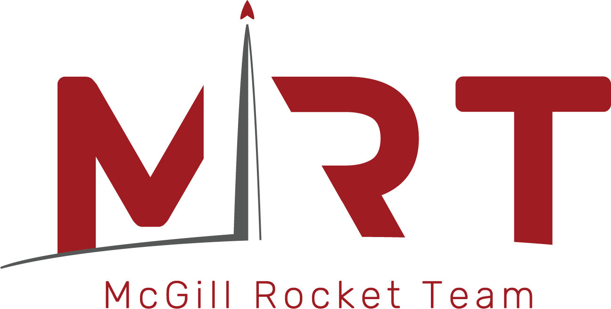

# Steady-Unsteady Simulator

**Hybrid Rocket Engine Simulator, with a proper GUI.**

*A steady-state and transient simulation tool for the McGill Rocket Team's self-pressurising N₂O / paraffin hybrid.*

 

 

## Design and simulate hybrid engine rockets

- **Steady-state analysis** for hotfire, fuel-mass convergence, and multi-variable parametric sweeps.
- **Unsteady (transient) simulation** covering the full time-domain of the tank, valve, injector, combustion chamber, nozzle, and ascent trajectory.
- Learn how to use the program with the [User Manual](https://github.com/Leo11235/MRT-Steady-Unsteady/blob/main/docs/user_manual.md) and how it works with the [Developer Manual](https://github.com/Leo11235/MRT-Steady-Unsteady/blob/main/docs/developer_manual.md). 

Built by the **McGill Rocket Team**

